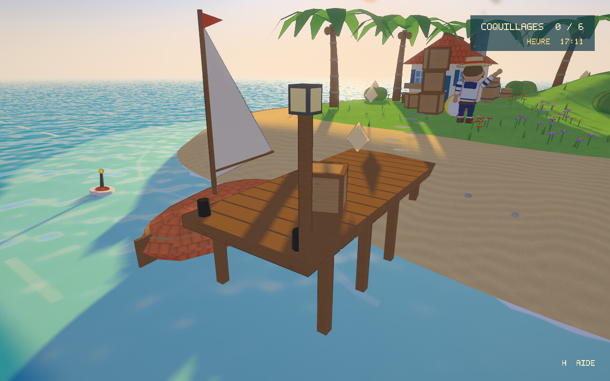
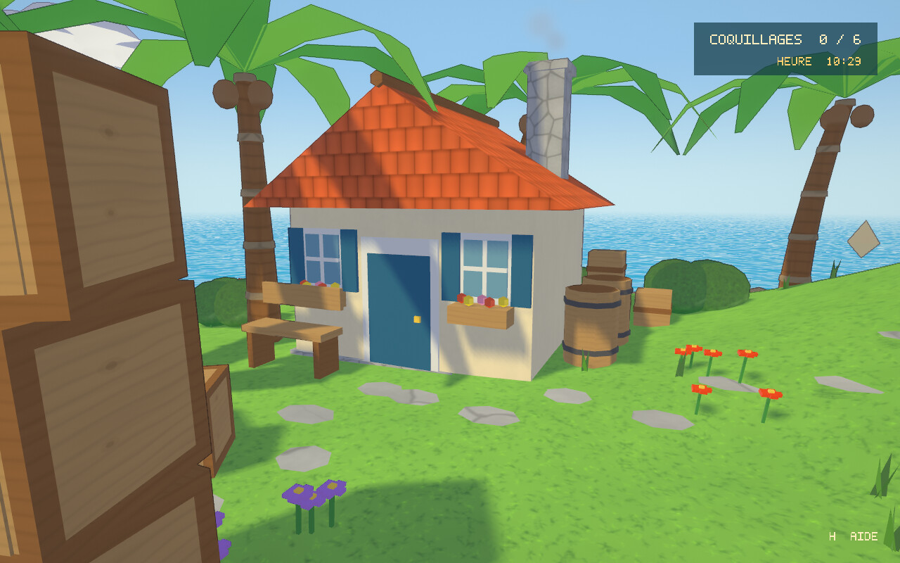
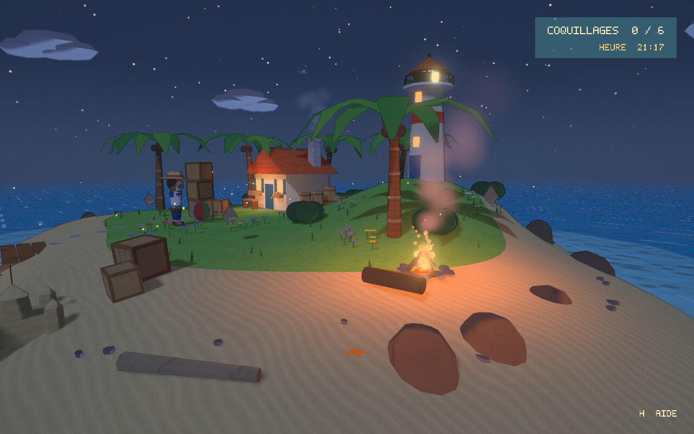

# Sillage

A 3D game engine written in Kotlin and nothing else. It is 3D from the first line, has its own physics engine, and is meant to be pleasant to use.


```kotlin
import sillage.*

fun main(args: Array<String>) {
    game("My game", args) {
        ground()
        box(1, at = vec(0, 3, -4)).dynamic()                    // a crate that falls and can be pushed
        sphere(.4, Color.RED, at = vec(2, 1, -4)).dynamic(bounce = .6)
        player(at = vec(0, 0, 0))                               // WASD, Space to jump, the camera follows
    }
}
```

That is a whole game: a window, a sky, a sun, a lawn, a crate and a ball that obey physics, and a player who walks, jumps and pushes them, with footsteps and knocks. Nothing to configure first.

## What is inside

- **Rendering**: Vulkan, called directly through the JDK's foreign function API. A soft toon look (two-tone light, rim light, haze) drawn in linear light, with a halo around bright things, ink lines along silhouettes and 4× anti-aliasing. The hours of the day (sunrise, sunset, night with moon and stars), shadows cast by the sun or the moon, lamps that light up at dusk, surfaces that glow, plants that sway in the wind, particles (fire, smoke, sparks, splashes, fireflies), water that finds its shores (lagoons, foam, surf, glitter). Detail textures painted by the engine itself (grass, sand, wood, planks, roof tiles, cobbles, rock, plaster, cloth, leaves, bark) and laid on models by their material names. Instanced drawing, two frames in flight, GPU timing. Runs in a window or off screen.
- **Windows**: its own Wayland client, with X11 as a fallback. Relative mouse, pointer lock, sharp output on high-DPI screens. Keys are read by position, so WASD works as ZQSD on an AZERTY keyboard.
- **Physics**: rigid bodies (boxes, spheres, capsules) on static triangle meshes, after Box2D v3's soft-step solver. Stable stacks, friction patches, mixed masses, rolling resistance, surfaces per material, sleep, rays and sphere sweeps, trigger zones, continuous collision for fast bodies and projectiles. Joints (ball, hinge, slider, fixed, distance, spring, rope, chains) with limits, motors and springs; raycast vehicles with suspension, steering, brakes and tyres that skid; characters carried by moving platforms. Up to 8 threads, with the same result to the bit whatever their number. Collision tests allocate nothing.
- **A character controller**: walks, runs, climbs steps, handles slopes, rides platforms, pushes crates according to their mass. Third or first person, switchable.
- **Sound**: its own mixer (48 voices, sounds placed in space), ALSA output. All the engine's sounds are synthesised: footsteps per surface, jumps, landings, impacts, waves, gulls.
- **Models**: glTF binary files as Blender exports them: hierarchies, node animations, skins (characters bent by a skeleton), images painted on the model (PNG and JPEG read by the engine's own decoders, alpha cut-outs). Material names in Blender set the surface (grass, sand, wood, stone, road, ice) and the detail texture.
- **Games**: a scene API in one file. Builders, physics in one call, players, pickups, zones, timers, a HUD with a built-in pixel font, several scenes, and runs without a window for tests.

No third-party library: the engine depends on the Kotlin standard library and on the system's own C libraries (Vulkan, Wayland, XCB, ALSA, libc).

## Requirements

- Linux on x86-64, with a Vulkan driver (Mesa or a vendor's) and Wayland or X11. Sound goes through ALSA, which on a desktop hands it to PipeWire or PulseAudio.
- JDK 25, which the build tool downloads by itself.

## Getting started

The project builds with the Kotlin Toolchain through the `./kotlin` script at its root.

```
./kotlin build
./kotlin run -m playground --jvm-args=--enable-native-access=ALL-UNNAMED     # a playground of shapes
./kotlin run -m demo --jvm-args=--enable-native-access=ALL-UNNAMED           # the island
./kotlin test                                                                # the engine's tests
```

Tab captures and frees the mouse, Escape quits. In the playground, B drops 400 crates. On the island, find the six shells; the day goes by in ten minutes, T makes the hours run.

| | |
|---|---|
|  |  |
|  |  |
|  |  |

A game is a module whose `module.yaml` depends on `//engine`. The [tutorial](docs/TUTORIAL.md) makes one from scratch.

## Documentation

| | |
|---|---|
| [Tutorial](docs/TUTORIAL.md) | a first game in eight steps |
| [Guide](docs/GUIDE.md) | everything the scene offers, by topic |
| [Physics](docs/PHYSICS.md) | the physics engine, on its own or under a scene |
| [Reference](docs/REFERENCE.md) | every public class and function |
| [Architecture](docs/ARCHITECTURE.md) | how the engine is built, for those who change it |

## Layout

| | |
|---|---|
| `engine/` | the engine and its tests |
| `playground/`, `demo/` | two games: shapes only, and an island made of models |
| `bench/` | physics benches |
| `qa/` | the quality battery: 65 checks of physics, collisions, character, rendering, loaders, API and speed |
| `tools/` | shader compilation, the demo's model generator, reference captures |

## Status

Sillage runs on Linux today. The window layer is ready for other systems, which are not written yet. Not there yet: compressed audio (WAV only), morph targets, cone limits for ragdolls. The [guide](docs/GUIDE.md) and the [physics page](docs/PHYSICS.md) list the limits in detail.
