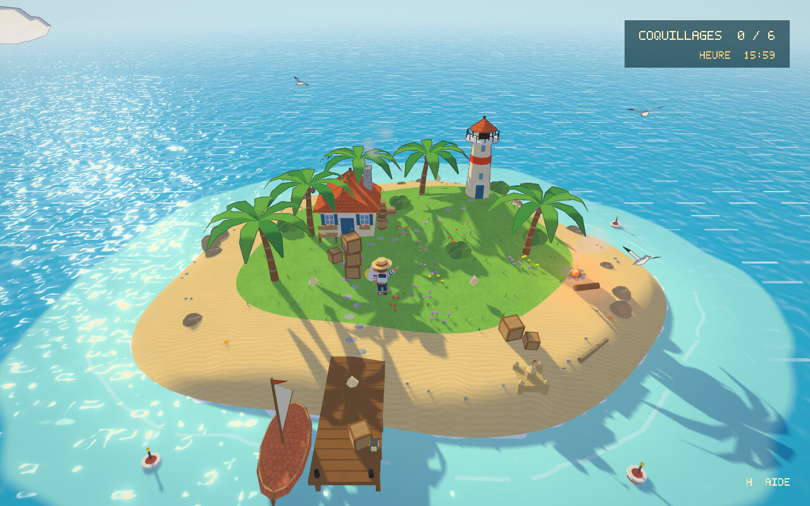
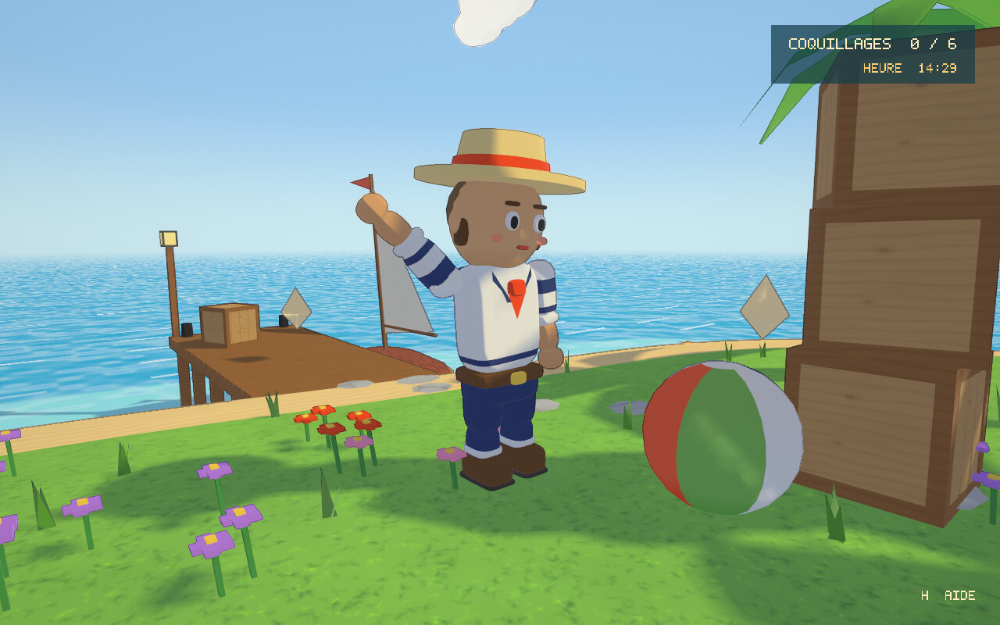
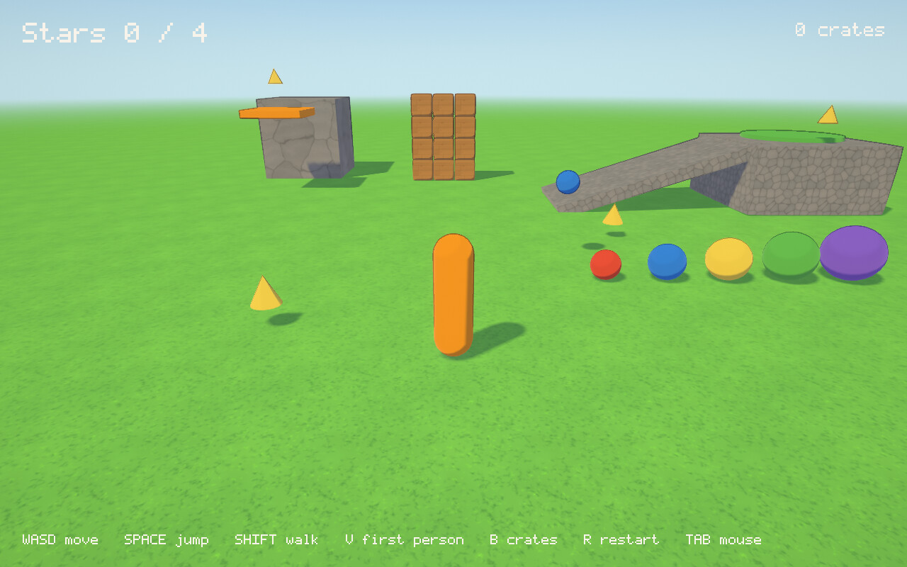
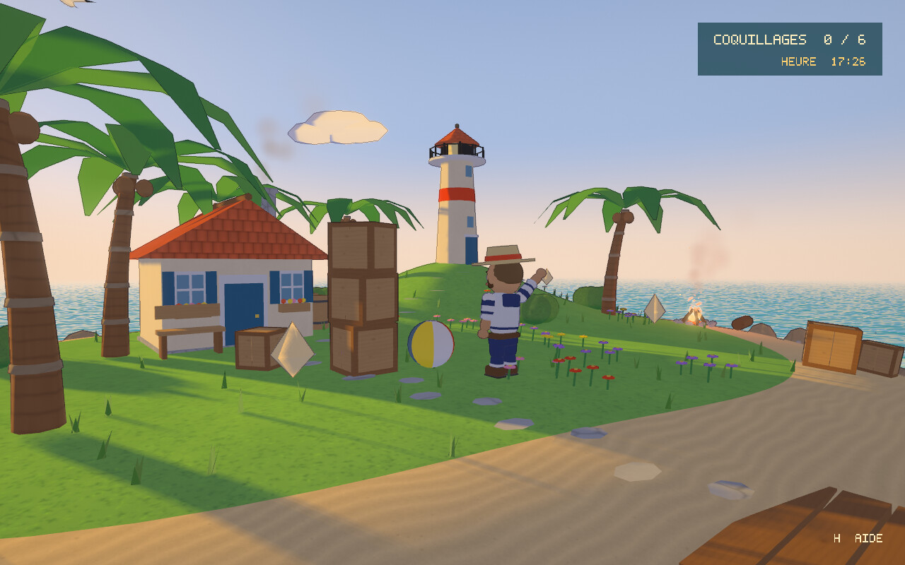
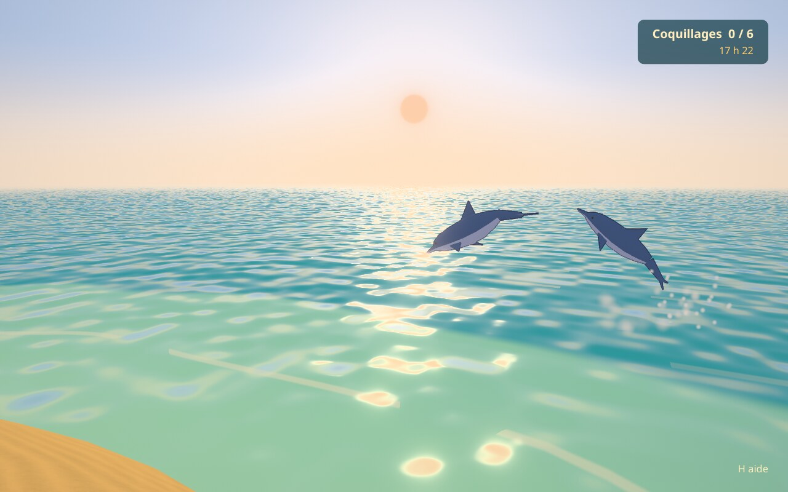
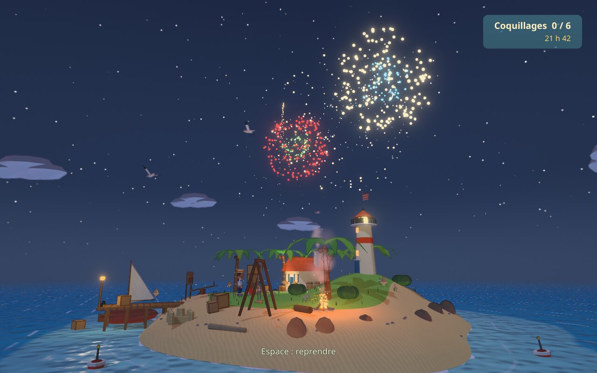
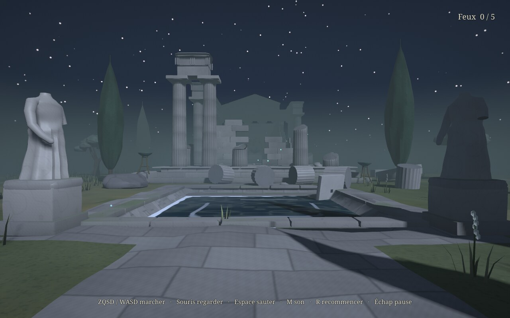
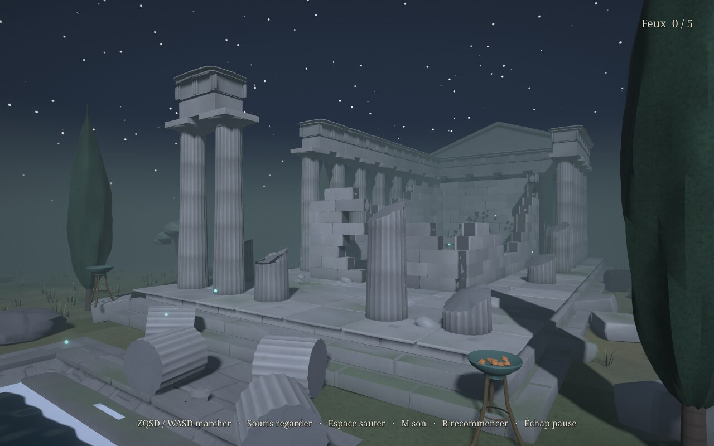

# Sillage

A 3D game engine written in Kotlin and nothing else. It is 3D from the first line, has its own physics engine, and is meant to be pleasant to use. The same game runs on Linux, a Raspberry Pi, Windows, FreeBSD, in a web page and on Android.



```kotlin
import sillage.*

fun main(args: Array<String>) {
    game("My game", args) {
        ground()
        box(1, at = vec(0, 3, -4)).dynamic()                    // a crate that falls and can be pushed
        sphere(.4, Color.RED, at = vec(2, 1, -4)).dynamic(bounce = .6)
        player(at = vec(0, 0, 0))                               // WASD, Space to jump, the camera follows
    }
}
```

That is a whole game: a window, a sky, a sun, a lawn, a crate and a ball that obey physics, and a player who walks, jumps and pushes them, with footsteps and knocks. Nothing to configure first.

## What is inside

- **Rendering**: Vulkan, called directly through the JDK's foreign function API. A soft toon look (two-tone light, rim light, haze) drawn in linear light, with a halo around bright things, ink lines along silhouettes and 4× anti-aliasing. The hours of the day (sunrise, sunset, night with moon and stars), shadows cast by the sun or the moon, lamps that light up at dusk, surfaces that glow, plants that sway in the wind, particles (fire, smoke, sparks, splashes, fireflies), water that finds its shores (lagoons, foam, surf, glitter). Detail textures painted by the engine itself (grass, sand, wood, planks, roof tiles, cobbles, rock, plaster, cloth, leaves, bark) and laid on models by their material names. Only what the camera sees is drawn (frustum, haze, draw distance; levels of detail by distance). Instanced drawing, two frames in flight, GPU timing. Runs in a window or off screen. The look is a setting, not a fate: `lighting.softness` goes from the drawn two-tone light to a smooth one that turns around shapes (stone, clay), and models may carry their colours vertex by vertex. A second renderer, on OpenGL ES 3 and WebGL 2, draws the same picture from the same shaders where there is no Vulkan (a web page, a phone).
- **Windows**: its own Wayland client, with X11 as a fallback; a Win32 window on Windows, a canvas in a page, a surface on Android. Relative mouse, pointer lock, sharp output on high-DPI screens. Keys are read by position, so WASD works as ZQSD on an AZERTY keyboard. A touch screen plays as a pad, with nothing to set up: left thumb to walk, right thumb to look, a tap to jump.
- **Physics**: rigid bodies (boxes, spheres, capsules, convex hulls, compounds) on static triangle meshes, floating in water that carries them (exact submerged volumes, drag, currents), after Box2D v3's soft-step solver. Stable stacks, friction patches, mixed masses, rolling resistance, surfaces per material, sleep, rays and sphere sweeps, trigger zones, continuous collision for fast bodies and projectiles. Joints (ball, hinge, slider, fixed, distance, spring, rope, chains, cone–twist for rag dolls) with limits, motors and springs; raycast vehicles with suspension, steering, brakes and tyres that skid; characters carried by moving platforms. Up to 8 threads, with the same result to the bit whatever their number. Collision tests allocate nothing.
- **A character controller**: walks, runs, climbs steps, handles slopes, rides platforms, pushes crates according to their mass. Third or first person, switchable.
- **Sound**: its own mixer (48 voices, sounds placed in space, Doppler effect, reverberation with presets and zones), its own Ogg Vorbis decoder (the same as libvorbis to 3·10⁻⁷), output through ALSA (Linux), OSS (FreeBSD), waveOut (Windows), Web Audio (a page) or AudioTrack (Android). The engine's own sounds are synthesised: footsteps per surface, jumps, landings, impacts, waves, gulls.
- **Blender as the editor**: objects named `col_…` become collision volumes, an empty `spawn` the player's start, Blender's lights lamps; custom properties make an object move (`sillage = dynamic`), a zone or a pickup the game finds by name.
- **Models**: glTF binary files as Blender exports them: hierarchies, node animations, skins (characters bent by a skeleton), images painted on the model (PNG and JPEG read by the engine's own decoders, alpha cut-outs). Material names in Blender set the surface (grass, sand, wood, stone, road, ice) and the detail texture.
- **Games**: a scene API in one file. Builders, physics in one call, players, pickups, zones, timers, scripts and tweens, several scenes, and runs without a window for tests.
- **Interface**: a HUD with a built-in pixel font or the system's fonts (TrueType and OpenType read and rasterised by the engine), rows and columns that size themselves, buttons, menus and a built-in pause menu, text fields fed by the keyboard's real layout (libxkbcommon).
- **Gamepads**: the PlayStation 5 DualSense in full (sticks, analog triggers, gyroscope, accelerometer, touchpad, battery, lightbar, player lights, rumble, adaptive triggers; USB and Bluetooth) and other pads through evdev; hot-plugging, rebindable actions, the player and the camera on the sticks, menus on the d-pad.
- **Tools**: `./sillage dev` reloads a game while it runs; F5–F8 show the physics, fly a free camera, pause and step.

No third-party library: the engine depends on the Kotlin standard library and on what each system already has (on Linux: Vulkan, Wayland, XCB, ALSA, libc; on Windows: Vulkan, user32, winmm; in a page: the browser; on Android: the platform).

## Where it runs

| | Drawn with | Packed with |
|---|---|---|
| Linux x86-64 | Vulkan | `./sillage package GAME` (one AppImage file) |
| Raspberry Pi 4, 5, 500 | Vulkan | `./sillage package GAME --arch aarch64` |
| Windows 10 and 11 | Vulkan | `./sillage package GAME --os windows` |
| FreeBSD (and NetBSD through its Linux emulation) | Vulkan | `./sillage package GAME --portable` |
| A web page | WebGL 2, from WebAssembly | `./sillage web GAME` |
| Android | OpenGL ES 3 | `./kotlin build -m GAME-android` |

Every package is made on the Linux computer where the game is written, and carries its own Java runtime where the system has none. [docs/PLATFORMS.md](docs/PLATFORMS.md) gives the recipe for each, and says plainly what each was tried on: Linux on a real desktop every day, the others on emulators, virtual machines and Wine so far.

## Requirements

To write a game:

- Linux on x86-64, with a Vulkan driver (Mesa or a vendor's) and Wayland or X11. Sound goes through ALSA, which on a desktop hands it to PipeWire or PulseAudio.
- JDK 25 and the Kotlin Toolchain, which `./kotlin` (and so `./sillage`) downloads by itself into `.tools/` on the first build.
- Nothing else: the shaders are compiled to SPIR-V in the repository (`tools/shaders.sh` and `glslc` only to change them). Packing for a Raspberry Pi uses Docker for its start-up cache, and packing for Windows uses Wine for the same, when they are there; both do without.

## Getting started

The `./sillage` command at the root drives everything (it uses the Kotlin Toolchain, `./kotlin`, for compiling).

```
./sillage run playground      # a playground of shapes
./sillage run demo            # the island
./sillage run temple          # the second demo: a ruined temple at night, in first person
./sillage dev demo            # the island, reloaded each time you save a file
./sillage new mygame          # a game of your own, ready to change
./sillage package demo        # one AppImage file with the game and its Java runtime
./sillage web demo --serve    # the island in a web page, at http://127.0.0.1:8080
./sillage test                # the engine's tests
```

Tab captures and frees the mouse, Escape opens the pause menu. In the playground, B drops 400 crates. On the island, you arrive by air from the open sea while a day goes by (Space skips it); find the six shells and night falls for the fireworks (then F fires a rocket whenever you like); the day goes by in ten minutes, T makes the hours run, and dolphins leap where you look out to sea.

| | |
|---|---|
|  |  |
|  |  |
|  |  |
|  |  |

The second demo, « L'oracle endormi », is there to show another look with the same engine: a ruined Greek temple under the stars, in first person, with five fires to light again. Smooth light on weathered stone, fluted columns, broken statues, a basin; no two-tone shading, no ink lines.

| | |
|---|---|
|  |  |

A game is a module of the project: `./sillage new mygame` makes one, `./sillage dev mygame` plays it and reloads it each time you save (code, models, images, sounds), keeping the player where it is. The [tutorial](docs/TUTORIAL.md) makes one from scratch.

## Documentation

| | |
|---|---|
| [Tutorial](docs/TUTORIAL.md) | a first game in eight steps |
| [Guide](docs/GUIDE.md) | everything the scene offers, by topic |
| [Physics](docs/PHYSICS.md) | the physics engine, on its own or under a scene |
| [Reference](docs/REFERENCE.md) | every public class and function |
| [Platforms](docs/PLATFORMS.md) | where a game runs, how to pack it for each system, what was tried |
| [Architecture](docs/ARCHITECTURE.md) | how the engine is built, for those who change it |

## Layout

| | |
|---|---|
| `core/` | maths, physics, file decoders, sound synthesis and mixing, in common Kotlin; usable alone |
| `engine/` | the scene API in common Kotlin and one backend per platform (desktop, web, Android), with its tests |
| `playground/`, `demo/`, `temple/` | three games: shapes only, an island made of models, a temple at night |
| `demo-web/`, `demo-android/`, `temple-web/`, `temple-android/` | the same games for a page and for a phone: a link to the game's source, nothing else |
| `bench/` | physics benches |
| `qa/` | the quality battery: 128 checks of physics, collisions, character, rendering (both renderers), loaders, API and speed |
| `tools/` | shader compilation, the demos' model generators, packaging helpers, reference captures |

## Status

Linux on x86-64 is where Sillage is written and played every day. The other systems have their backend, their packaging command and their recipe, and were tried as far as a single laptop allows (an emulated ARM processor, virtual machines, Wine, the Android emulator, a headless browser): a real Raspberry Pi, a real Windows, a real phone are the next step, and reports are welcome. Game pads are read on Linux only; elsewhere keyboard, mouse and touch. No macOS or iOS.

Not there yet: streamed audio (files are decoded whole into memory), MP3, morph targets. The [guide](docs/GUIDE.md) and the [physics page](docs/PHYSICS.md) list the limits in detail.

## Licence

Sillage is free software under the [Apache License, Version 2.0](LICENSE) (see [NOTICE](NOTICE)).
